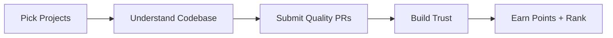
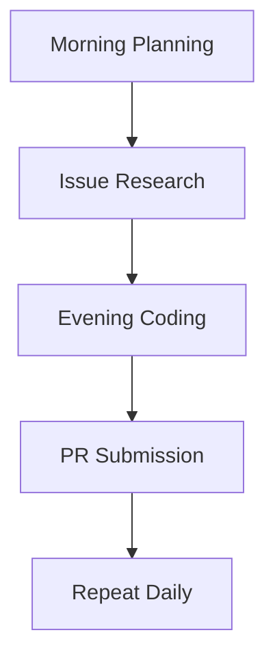

---

> Standing out in a world of 180M+ developers is not about knowing more  
> It is about proving you can build, collaborate, and stay consistent

---

The global developer ecosystem is growing rapidly, with India on track to become the largest hub by 2028. In this environment, just learning to code is not enough.

You need proof of work.

That is where open source changes everything.

With **GSSoC 2026 approaching**, here is a complete breakdown of how I secured:

```yaml
Rank: #2
Points: 2,014
Duration: 120+ days of contributions
```

And more importantly, what you can learn from it.

---

<div style="display: flex; gap: 16px; align-items: flex-start;">
  
  
</div>


*2,361 contributions. Consistency over months, not days.*

---

## 🔑 Key Takeaways

- Consistency beats bursts of effort  
- Quality PRs matter more than quantity  
- Going deep into projects builds trust faster  

---

## What is GSSoC?

**GirlScript Summer of Code (GSSoC)** is a 4-month open-source program connecting contributors with real-world projects.

```yaml
Participants: 25,000+
Duration: 4 months
Scoring: Points-based leaderboard
```

It is beginner-friendly to enter  
But highly competitive to rank in

---

## 💰 What You Actually Get if you secure the 2nd Rank (which I did :))

Beyond ranking, the tangible rewards included:

- ₹10,000 cash prize  
- Official swags (T-shirt, stickers)  
- Letter of Recommendation  
- Social media recognition  

---

## 🧭 My Strategy (Simplified Flow)



---

## Projects I Focused On

Instead of jumping across repos, I focused on depth.

---

### 💗 TalkHeal  
[](https://talkheal.streamlit.app)

An AI-powered mental health support assistant built with Python and Streamlit.

- Worked on backend improvements  
- Enhanced feature logic  
- Improved documentation  

---

### 🟣 Venturalink  
[](https://venturalink.vercel.app)

Venturalink bridges the gap between investors and entrepreneurs in India.

- Built role-based dashboards  
- Improved UI interactions  
- Focused on real-world usability  

---

### 🤎 BuildOnCoffee  
[](https://build-on-coffee.vercel.app)

A platform for discovering developer tools and CS resources.

- Optimized frontend components  
- Fixed UI issues  
- Improved usability  

---

## 🧠 Why Depth Worked

```diff
- Random contributions across many repos
+ Deep contributions in few projects
```

This helped in:

- Understanding architecture  
- Building trust with maintainers  
- Proposing meaningful features  

---

## 🧾 My PR Strategy

Every PR followed one rule:

> Explain WHY, not just WHAT

Checklist:

- Clear title  
- Context and reasoning  
- Screenshots for UI  
- Clean commits  
- Linked issue  

---

## 🔁 Consistency System



---

### Daily Routine:

- Morning: Identify issues  
- Evening: Code and submit  

On low days:

- Documentation  
- PR reviews  
- Code exploration  

---

## 📊 What I Gained

The rank was just a result.

Real gains:

- Git mastery (rebasing, conflicts)  
- Full-stack exposure  
- Code review skills  
- Community trust  

---

## Open Source Beyond GSSoC

GSSoC is a strong starting point, not the finish line.

The habits that earned the rank — reading unfamiliar codebases, writing clear PRs, and staying consistent — carry over to any project, any team, and any program. Keep contributing where the maintainers are active and the problems are real. That is where the compounding happens.

---

## ❓ FAQ

<details>
<summary><strong>How many points are needed for Top 10?</strong></summary>

Around 2000+ points was required for top ranks in 2025.

</details>

<details>
<summary><strong>Can beginners participate?</strong></summary>

Yes. Many tasks include documentation, UI fixes, and beginner-friendly issues.

</details>

<details>
<summary><strong>How to choose projects?</strong></summary>

Pick repositories with active maintainers and consistent issue flow.

</details>

---

## 🖤 Final Thoughts

```diff
Do not chase rank.
Chase contribution.
```

Ranking is a byproduct of:

- Showing up daily  
- Writing clean code  
- Respecting collaboration  

---

## Your Next Step

[](https://gssoc.girlscript.org/)

Pick one repository this week and open your first PR. Then do it again next week.

---

*Start contributing. Stay consistent. Let the results follow.*
